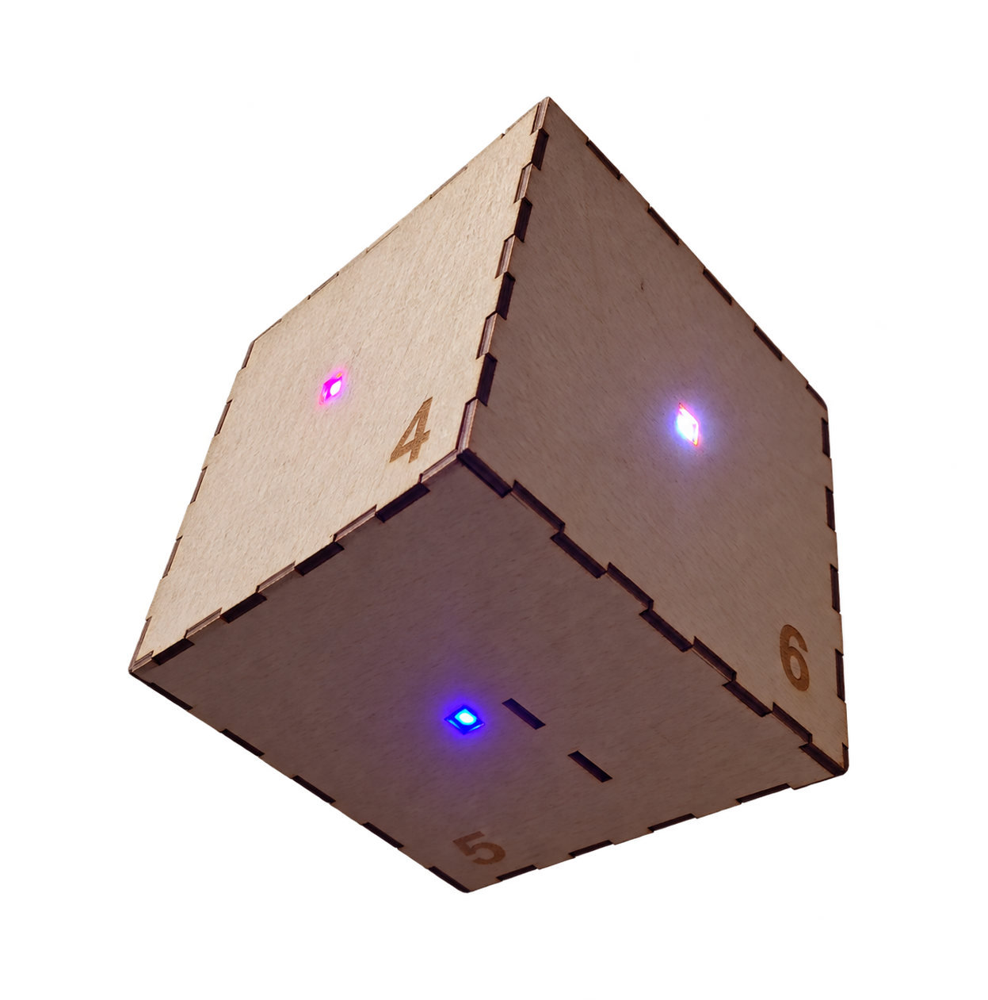

# Activity Cube


## Project features

- Detects six cube positions using an MPU6500 and ESP32.
- Shows live roll, pitch, yaw, and detected position on a Wi-Fi web dashboard.
- Uses the WS2812 LEDs and dashboard colors to provide visual feedback.
- Records position changes and displays orientation history with uptime and
  network-synchronized timestamps.
- Summarizes time spent in each position, including daily and all-time totals
  and percentages.
- Lists, reads, and uploads files through the web server.
- Enters deep sleep after a 3-second button hold or 30 seconds without a
  detected orientation change, and wakes from either the button or MPU6500
  wake-on-motion.

## Contact and contributions

This is a personal project, currently developed without external contributions.
If you have questions, feel free to [start a discussion on GitHub](https://github.com/Heiko-crt/ActivityCube/discussions) — I welcome the conversation.

## MPU6500 orientation sensor

Connect the MPU6500 module to the ESP32 DevKit as follows:

| MPU6500 | ESP32 DevKit |
| --- | --- |
| VCC | 3.3 V |
| GND | GND |
| SDA | GPIO 21 |
| SCL | GPIO 22 |
| INT | GPIO 32 |

For the ESP32-C3 target, the driver uses GPIO 4 (SDA) and GPIO 5 (SCL).
Use 3.3 V-compatible I2C pull-ups; many modules already include them. The
driver checks both common I2C addresses (0x68 and 0x69) and accepts
WHO_AM_I values 0x68 (MPU-6050) and 0x70 (MPU-6500).

`mpu6050_read_orientation()` returns roll, pitch, and yaw in degrees.
Roll and pitch use accelerometer/gyroscope complementary filtering. Yaw is
integrated from the gyroscope only, so it is relative and will drift over time
because the MPU6500 has no magnetometer. When detected, the application outputs
all three angles to UART once per second and serves them as JSON at `/orientation`.
The home page displays the angles and refreshes them once per second. It also
shows the detected cube position; the page background changes color for each
of the six recognized positions and returns to a neutral color when the
position is unknown or the sensor is unavailable.

## Orientation history

Each detected change in cube position is appended to
`/littlefs/orientation_history.csv`, including transitions to an undefined
orientation.

The CSV and the web history table contain separate columns for time since
startup and NTP-based local time. The NTP time is `undefined` until time
synchronization succeeds. The home page provides buttons to refresh or clear
the history.

The dashboard also summarizes the time and percentage spent in each of the six
positions and in the undefined position, both for today and across the recorded
history. Each position has a colored row, followed by a total-time row.

## UART log

UART is configured at 115200 baud. The firmware continuously sends a message
counter and the received UART input on the serial connection. It also prints
the current MPU6050 roll, pitch, and yaw values once per second.

The ESP-IDF log records application events and errors, including Wi-Fi
connection status, sensor initialization and availability, deep-sleep entry,
orientation-history updates, and wake-on-motion configuration.

The UART log also records each MPU6500 I2C transaction: 7-bit device address,
register/data bytes sent, received bytes, and the ESP-IDF result. Successful
transaction results mean the driver observed ACKs; failures report the driver
error (for example, a NACK or timeout). Because sensor samples are read every
100 ms, these diagnostics produce frequent log output while the sensor is active.

## Power button

Connect a normally open pushbutton between GPIO 33 and GND on the ESP32 DevKit.
Holding it for 3 seconds sets the cube orientation to undefined and records
that event, lights all WS2812 LEDs red for one second, turns them off, and
enters deep sleep. The hold duration can be changed at build time by defining
`SLEEP_BUTTON_HOLD_MS`. The device also enters deep sleep after 30 seconds
without a detected cube-orientation change.

On a classic ESP32 (such as the ESP32 DevKit), connect the MPU6500 `INT` pin to
GPIO 32, with a common ground and 3.3 V-compatible logic. During deep sleep the
MPU6500 remains in low-power wake-on-motion mode; detected motion wakes the
ESP32, which then boots normally. The wake-on-motion threshold is 600 mg and
the accelerometer sampling rate is 15.63 Hz. Wake-on-motion requires an MPU6500;
the MPU-6050 does not support this feature. The GPIO 32 wake connection is not
available on the ESP32-C3 target.

The firmware configures GPIO 33 for active-low button wake and GPIO 32 for the
MPU6500's active-high, latched motion interrupt. Both wake sources should be
tested with the actual board and sensor wiring. A button-initiated sleep only
wakes from the button; the MPU6500 is put into sleep mode. An inactivity-
initiated sleep also enables MPU6500 wake-on-motion.

## Specific hardware details

An HT7333 linear voltage regulator is used for battery supply instead of the
ESP32 board's onboard AMS1117. The HT7333 has a much lower quiescent current,
which is important for battery operation and deep-sleep runtime.

When battery and USB power are connected in parallel, a Schottky diode should
be added to prevent backward current. Suitable Schottky diodes tested for this
setup caused too much voltage drop, so the ESP32 did not power up reliably.
The diode has therefore been left out, but this remains a hardware risk that
should be addressed when the power supply is revised.

An additional 100 nF capacitor is connected to the ESP32 `EN` pin. It lengthens
the reset pulse triggered by the CP2102 during flash initialization, helping
ensure that the device remains in bootloader mode until flashing is complete.

## Wi-Fi credentials

Copy `src/wifi_credentials.h.example` to `src/wifi_credentials.h` and set your
local Wi-Fi SSID and password there. The credentials header is ignored by Git;
do not commit it. Without this local file, Wi-Fi startup reports that the SSID
is not configured.

## Webpage

After the ESP32 has connected to Wi-Fi, open `http://ESP32-IP/` in a browser.
Replace `ESP32-IP` with the IP address assigned to the ESP32.

The dashboard displays live roll, pitch, yaw, and the detected cube position.
It refreshes the sensor values once per second and changes its background color
for each of the six recognized positions. It also provides:

- Current uptime and NTP-based local time.
- Today and all-time statistics for time spent in every position.
- The orientation history, including changes to an undefined position.
- Controls to refresh or clear the orientation history.

The following browser endpoints provide the data used by the dashboard:

| Endpoint | Content |
| --- | --- |
| `/` | Web dashboard |
| `/orientation` | Current roll, pitch, yaw, and sensor availability as JSON |
| `/counter` | UART counter |
| `/time` | Current network-synchronized time |
| `/statistics` | Daily and all-time position statistics as JSON |
| `/history` | Orientation history as HTML |

## Accessing files

The ESP32 exposes files stored in LittleFS under `/files`. Replace
`ESP32-IP` with the IP address of the ESP32.

List the stored files:

```text
http://ESP32-IP/files/
```

The same operation can be run with `curl.exe`:

```powershell
curl.exe "http://ESP32-IP/files/"
```

Upload a file with `curl.exe`:

```powershell
curl.exe --upload-file test.txt "http://ESP32-IP/files/test.txt"
```

Read a file in a browser:

```text
http://ESP32-IP/files/test.txt
```

Read a file with `curl.exe`:

```powershell
curl.exe "http://ESP32-IP/files/test.txt"
```

File uploads are limited to 265 KiB.

## Open topics

- Further reduce current consumption in deep sleep by disabling power to the
  WS2812 LED chain (already specified in schematic)
- Change to a different ESP32 board with improved quiescent current.
- Change from the current battery setup to a Li-Ion battery.
- Change the communication interface from Wi-Fi to Bluetooth.
- Add battery level status.
- Improve the housing to make mounting the electronics inside easier.
